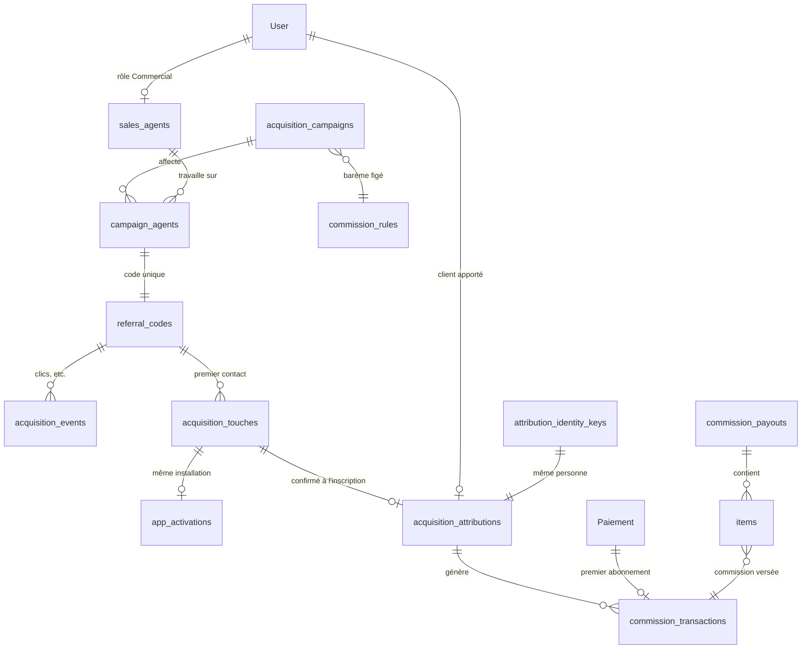

# Module commercial Kitunga : modèle de données

Suivi des commerciaux, des campagnes, des clients apportés et des commissions.
Base : Cloud Firestore. Code : `kitunga/acquisition/`.

## Principes

- **Tout est écrit par le serveur.** Les règles Firestore interdisent toute
  écriture depuis une application, y compris le tableau de bord admin : les
  actions passent par des fonctions qui vérifient, puis journalisent dans
  `audit_logs` dans la même transaction.
- **Unicité garantie par la base.** Les documents qui ne doivent exister qu'une
  fois portent un identifiant déterministe et sont créés avec `create()`, qui
  échoue si le document existe (`store.createOnce`, transactions). Exemples :
  une attribution par client (`acquisition_attributions/{clientUid}`), une
  commission par type et par client (`commission_transactions/first_subscription_{clientUid}`).
- **Statuts contrôlés.** Chaque changement de statut suit `TRANSITIONS`
  (`model.js`) et passe par `store.transition` (transaction + audit).
- **Rien n'est supprimé.** Campagnes, attributions, commissions et versements
  sont archivés, jamais effacés. Une commission versée n'est jamais modifiée :
  un remboursement crée une contrepassation (`reversal_{commissionId}`).
- **Montants** en FCFA entiers (`XAF`). **Dates** écrites par le serveur.
- **Aucun identifiant matériel** : l'installation est identifiée par un UUID
  tiré au hasard par l'application.
- **Téléphones jamais en clair** dans le module : empreinte HMAC-SHA256
  (`identityKey`) avec la clé secrète `ACQ_IDENTITY_KEY`.

## Schéma



## Collections

Lecture : **A** = admin, **C** = le commercial concerné (`agent_uid` = son
compte), **—** = personne. Écriture : serveur seulement, pour toutes.

| Collection | Identifiant | Contenu principal | Lecture |
|---|---|---|---|
| `sales_agent_keys` | empreinte du téléphone | `agent_uid` : deux commerciaux ne partagent pas un numéro | A |
| `sales_agents` | uid du compte | `agent_code` (KTG001), `display_name`, `phone`, `email`, `status` (active, suspended, archived), `payout_method`, `identity_key`, `created_by`, `created_at` | A, C (sa fiche) |
| `acquisition_campaigns` | auto | `name`, `description`, `objective`, `starts_at`, `ends_at`, `status` (draft, scheduled, active, paused, completed, archived), `rule_id`, `grace_days`, `hold_days`, `closed_at`, `archived_at` | A, tout commercial |
| `campaign_agents` | auto | `campaign_id`, `agent_uid`, `starts_at`, `ends_at`, `status` (active, ended, cancelled), `referral_code`, `allow_overlap`, `overlap_reason` | A, C |
| `referral_codes` | le code (KTG001-X7P9) | `assignment_id`, `campaign_id`, `agent_uid`, `valid_from`, `valid_until`, `status` (active, disabled) | A, C |
| `acquisition_touches` | UUID d'installation | premier contact d'un appareil : `code`, `campaign_id`, `agent_uid`, `assignment_id`, `source` (install_referrer, link, manual), `status` (provisional, confirmed, superseded, rejected), `user_uid`, `touched_at` | A |
| `acquisition_attributions` | uid du client | `agent_uid`, `campaign_id`, `assignment_id`, `code`, `touch_id`, `identity_key`, `status` (confirmed, rejected, void), `confirmed_at`, `client_summary` (prénom abrégé, date d'inscription, abonné oui/non) | A, C |
| `attribution_identity_keys` | empreinte du téléphone | `user_uid`, `agent_uid`, `created_at` : la même personne ne change pas de commercial avec un nouveau compte | A |
| `app_activations` | UUID d'installation | `verified`, `integrity_verdict`, `referrer_click_at`, `install_begin_at`, `user_uid`, `activated_at` | A |
| `commission_rules` | auto | barème **figé** : `activation_amount`, `first_subscription_amount`, `eligible_plans`, `currency`, `created_by`, `created_at`. Changer les tarifs = créer un nouveau barème | A, tout commercial |
| `commission_transactions` | `activation_{client}`, `first_subscription_{client}`, `reversal_{id}` | `agent_uid`, `client_uid`, `campaign_id`, `assignment_id`, `type`, `rule_id`, `amount`, `currency`, `source_ref` (Paiement ou activation), `status` (pending, approved, reserved, paid, reversed, rejected), `eligible_at`, `payout_id`, `created_at` | A, C |
| `commission_payouts` | auto | `agent_uid`, `amount`, `currency`, `method` (mobile_money, bank), `status` (requested, approved, rejected, paid), `external_reference` (saisie à la main : aucun virement automatique), `requested_at`, `decided_by`, `paid_at` | A, C |
| `commission_payouts/{id}/items` | id de commission | `agent_uid`, `commission_id`, `amount` | A, C |
| `acquisition_events` | auto | `type` (click, install, activation, signup, subscription, fraud_flag), `code`, `campaign_id`, `agent_uid`, `ip_hash`, `created_at` | A |
| `audit_logs` | auto | `actor_uid`, `actor_role`, `action`, `target`, `details`, `created_at` | A |
| `acquisition_counters` | nom du compteur | numéros de commercial (KTG001…) | A |

Réutilisées sans changement : `User` (comptes, rôle, `subscribe_close_at`)
et `Paiement` (abonnements payés, vérifiés par MTN côté serveur). Il n'y a pas
de deuxième système d'abonnement.

## Rôle Commercial

- Compte créé uniquement par un admin (`kitungaCreateSalesAgent`) : personne
  ne peut se donner ce rôle (règles Firestore).
- Profil `User` minimal (`role: "Commercial"`) et fiche `sales_agents` du même
  identifiant. Numéro KTG001, KTG002… attribué par un compteur en transaction.
- Un commercial ne commande pas : seuls Seller, Deliver et Admin sont
  dispensés d'abonnement, tout autre rôle doit être un client abonné.
- Dans l'application, un compte Commercial arrive sur son propre accueil
  (`lib/sales/`) au lieu de l'accueil client.
- Suspendu : il se connecte toujours, mais ses liens ne rapportent plus.
  Archivé : connexion désactivée, historique conservé.

## Fonctions

| Fonction | Réservée à | Rôle |
|---|---|---|
| `kitungaCreateSalesAgent` | admin | Crée le compte, le profil et la fiche (email, mot de passe de 8 caractères minimum, nom, téléphone, moyen de paiement facultatif) |
| `kitungaUpdateSalesAgent` | admin | Modifie nom, téléphone ou moyen de paiement |
| `kitungaSetSalesAgentStatus` | admin | `active`, `suspended` ou `archived`, motif obligatoire sauf réactivation |
| `kitungaCreateCommissionRule` | admin | Barème figé : montants activation et premier abonnement, formules éligibles |
| `kitungaCreateCampaign` | admin | Campagne en brouillon : nom, textes, dates, barème, délai après la fin (30 j par défaut), délai de sécurité (7 j) |
| `kitungaUpdateCampaign` | admin | Brouillon ou programmée : tout ; lancée : textes et date de fin seulement |
| `kitungaSetCampaignStatus` | admin | Programmer, activer, mettre en pause, clôturer (motif si anticipé), archiver |
| `kitungaAssignAgent` | admin | Affecte un commercial actif, dans les dates de la campagne ; génère son code |
| `kitungaEndAssignment` | admin | Termine ou annule une affectation (motif) ; son code est désactivé |
| `kitungaReferralRedirect` | public (HTTP) | Lien `/r/{code}` : enregistre le clic, puis Google Play avec le code (Android) ou page avec le code à saisir (iPhone, ordinateur) |
| `kitungaRecordTouch` | utilisateur connecté (visiteur ou compte) | Premier contact provisoire d'un appareil, envoyé par l'application |
| `kitungaClaimAttribution` | client connecté | Confirme l'attribution à l'inscription (premier contact de l'appareil ou code saisi) |
| `kitungaRecordActivation` | utilisateur connecté + jeton App Check | Activation de l'installation, vérifiée par Play Integrity |
| `kitungaOnSubscriptionPaid` | déclencheur `Paiement/{id}` | Abonnement passé à « Réussi » (vérifié chez MTN) : commission « premier abonnement » |
| `kitungaOnAttributionCreated` | déclencheur `acquisition_attributions/{uid}` | Commission d'activation si l'activation est déjà attestée |
| `kitungaOnActivationVerified` | déclencheur `app_activations/{id}` | Activation devenue vérifiée : commission d'activation des clients liés |
| `kitungaCampaignSchedule` | automatique (15 min) | Active les campagnes programmées, clôture les campagnes et affectations arrivées à leur fin |

### Règles des campagnes

- **Barème anti-fraude** : activation + premier abonnement doit rester sous le
  prix de la formule éligible la moins chère (sinon payer de faux abonnements
  rapporte de l'argent). Un barème ne se modifie jamais.
- **Activation** seulement entre la date de début et la date de fin ; une
  campagne programmée démarre seule à sa date.
- **Chevauchement** : refusé, sauf `allowOverlap` avec un motif écrit
  (`overlap_reason`, journalisé). La fiche du commercial sert de verrou : deux
  affectations simultanées ne peuvent pas passer toutes les deux.
- **Clôture** (manuelle ou à la date de fin) : la campagne passe d'abord à
  `completed`, ce qui bloque les nouvelles acquisitions ; ses affectations
  sont ensuite fermées et ses codes désactivés, par lots. Si la fermeture est
  interrompue, le traitement planifié la termine (`assignments_closed`).

Déploiement (après avoir créé le secret `ACQ_IDENTITY_KEY`) :

```bash
cd firebase
firebase functions:secrets:set ACQ_IDENTITY_KEY -P kitunga-xtvpe4
firebase deploy --only firestore:indexes,functions:kitungaOnSubscriptionPaid,functions:kitungaOnAttributionCreated,functions:kitungaOnActivationVerified,functions:kitungaRecordActivation,functions:kitungaClaimAttribution,functions:kitungaReferralRedirect,functions:kitungaRecordTouch,functions:kitungaCreateSalesAgent,functions:kitungaUpdateSalesAgent,functions:kitungaSetSalesAgentStatus,functions:kitungaCreateCommissionRule,functions:kitungaCreateCampaign,functions:kitungaUpdateCampaign,functions:kitungaSetCampaignStatus,functions:kitungaAssignAgent,functions:kitungaEndAssignment,functions:kitungaCampaignSchedule -P kitunga-xtvpe4
```

## Liens, QR codes et premier contact

1. **Lien** : `https://kitunga-xtvpe4.web.app/r/KTG001-X7P9` (règle
   `/r/**` de `firebase.json` à la racine, avant le renvoi vers
   l'application). Le QR code encode ce lien (`lib/sales/referral_qr.dart`).
2. **Clic** : enregistré dans `acquisition_events` (`type: click`) si le code,
   la campagne et le commercial sont actifs. Ne comptent pas : aperçus de liens
   (WhatsApp, Facebook, Telegram…), robots, requêtes `HEAD`, et au-delà de 30
   clics par adresse IP et par jour. L'adresse IP n'est jamais stockée : seule
   une empreinte qui change chaque jour. Réponse jamais mise en cache.
3. **Android** : renvoi vers Google Play avec
   `referrer=utm_source=kitunga&utm_medium=commercial&kitunga_code=…&kitunga_click=…`.
   Code invalide ou arrêté : Google Play sans code. Base indisponible : Google
   Play quand même (le parcours ne casse jamais).
4. **Premier lancement** (`lib/backend/acquisition.dart`) : l'application lit
   ce texte (Google Play Install Referrer), garde le code sur le téléphone avec
   un identifiant d'installation aléatoire, puis appelle `kitungaRecordTouch`
   dès qu'un utilisateur est connecté. En cas d'échec réseau, nouvel essai au
   lancement suivant ; rien ne bloque l'application.
5. **Premier contact** (`acquisition_touches/{installation}`) : créé une seule
   fois par appareil, statut `provisional`. Le clic est marqué vérifié s'il
   correspond à un vrai clic du même code. Refusé : compte commercial, admin,
   vendeur ou livreur, client déjà attribué, code arrêté, plus de 3
   installations par compte.

## Inscription : attribution définitive

À la création du compte (`lib/mobile/connect/sign/sign_widget.dart`), puis à
chaque lancement tant que ce n'est pas fait, l'application appelle
`kitungaClaimAttribution` avec son identifiant d'installation et, le cas
échéant, le code saisi dans « Code commercial (facultatif) » (prérempli et
verrouillé si le code est arrivé avec l'installation).

1. **Premier contact d'abord** : le contact provisoire de l'appareil est
   prioritaire sur un code saisi (FIRST TOUCH). Sinon, le code saisi est
   revérifié (actif, campagne active, commercial actif).
2. **Nouveau client seulement** : compte Firebase Auth créé au plus 72 h avant
   le contact (date de Firebase Auth, non modifiable par l'utilisateur).
   Sinon : `existing_client`, aucune attribution.
3. **Même personne** : empreinte du téléphone du profil dans
   `attribution_identity_keys`. Un nouveau compte avec un téléphone déjà connu
   est enregistré `rejected` (`duplicate_person`, `duplicate_of`) : aucune
   commission, le commercial d'origine garde son client.
4. **Auto-parrainage** : téléphone du client = téléphone du commercial →
   `rejected` (`self_referral`).
5. **Une seule fois** : `acquisition_attributions/{uid}` n'est créé qu'une
   fois ; demandes simultanées comprises. Le contact utilisé passe à
   `confirmed` et ne sert plus à un autre compte.
6. **Vue du commercial** : `client_summary` = prénom et initiale, date
   d'inscription, abonné oui/non. Jamais de téléphone ni d'email.

Le téléphone du profil est déclaratif : le numéro MTN du premier abonnement
payé sera revérifié avant toute commission (phase 7).

## Activation vérifiée (App Check / Play Integrity)

Configuration faite dans les consoles : projet Cloud `kitunga-xtvpe4` associé
dans la Play Console (10 000 vérifications par jour), API Play Integrity
activée, application `com.ntemoconsulting.kitunga` enregistrée dans App Check
avec l'empreinte SHA-256 de la clé de signature Google Play.

- **Application** (`lib/backend/acquisition.dart`) : App Check activé sur
  Android seulement, sans rafraîchissement automatique (quota). Si un code
  commercial est présent, l'application demande un jeton **à usage unique** et
  appelle `kitungaRecordActivation` (en-tête `X-Firebase-AppCheck`).
- **Serveur** : fonction déployée avec `consumeAppCheckToken` (le jeton est
  consommé). L'activation (`app_activations/{installation}`) est
  `verified: true` seulement si le jeton est valide, vient de l'application
  `1:44272206573:android:55bb2e574ee67cea5b02e4` et n'a jamais servi. Sinon
  `verified: false` avec le motif (`no_app_check`, `other_app`,
  `replayed_token`) ; revérifiable, 10 essais au plus.
- **Commission d'activation** (phase 7) : attribution confirmée + activation
  vérifiée de la même installation (`installation_id` de l'attribution).
- **Version de test** (debug) : Play Integrity refuse les APK installés hors
  Google Play ; le fournisseur « debug » est utilisé. Pour tester, copier le
  jeton de débogage affiché dans les journaux Android (`adb logcat | grep
  DebugAppCheckProvider`) dans App Check → Applications → ⋮ → Gérer les jetons
  de débogage. Ne jamais mettre ce jeton dans le code.
- **Ne jamais activer « Appliquer »** dans App Check pour Firestore, Storage
  ou Authentication : toutes les versions de l'application déjà installées,
  sans App Check, seraient bloquées.

## Commissions générées

| Commission | Conditions | Identifiant |
|---|---|---|
| Premier abonnement | Paiement `kind: subscription` passé à `Réussi` (écrit par le serveur seul, après vérification MTN), montant > 0 ; attribution `confirmed` ; aucun autre abonnement payé avant ; formule dans `eligible_plans` du barème ; contact pendant l'affectation et paiement au plus `grace_days` jours après sa fin | `first_subscription_{client}` |
| Activation | Attribution `confirmed` + activation `verified` de l'installation d'inscription ; même fenêtre de temps | `activation_{client}` |

- Statut à la création : `pending`, validable par l'admin à partir de
  `eligible_at` (création + `hold_days`). Montant recopié du barème.
- `rejected` (`payer_is_agent`) : le numéro MTN qui paie est celui du
  commercial.
- Signalements (`flags`, la commission reste en attente) : `shared_payer`
  (un même numéro MTN a payé pour plusieurs clients, voir
  `commission_payer_keys`), `agent_not_active`, `assignment_cancelled`.
- Pas de commission : un événement `commission_skipped` avec le motif
  (`plan_not_eligible`, `not_first_subscription`, `out_of_window`…) est
  enregistré quand le client est attribué.
- Une campagne ne peut être archivée tant que des commissions sont
  `pending`, `approved` ou `reserved`.
- Remboursement d'un abonnement : il n'existe pas de remboursement
  automatique des abonnements ; la contrepassation sera une action admin
  (phase 8).

### Limites du suivi

- **Android** : le code n'arrive que si l'application est installée depuis le
  lien. Installée autrement puis lien ouvert ensuite : pas de code (saisie
  manuelle à l'inscription, phase 6). Une application modifiée peut inventer
  un code : c'est pourquoi le contact reste provisoire et que l'activation
  sera attestée (Play Integrity, phase 6).
- **iPhone** : aucun équivalent automatique ; la page affiche le code à
  saisir à l'inscription. L'application iOS n'est pas publiée.
- **Désinstallation** : l'identifiant d'installation est perdu ; un nouveau
  contact sur le même appareil reste possible tant que la personne n'a pas de
  compte. Après l'inscription, l'attribution est liée au compte et au
  téléphone (phase 6) et ne change plus.

## Transitions de statut

| Objet | Transitions autorisées |
|---|---|
| Campagne | draft → scheduled, active, archived ; scheduled → draft, active, paused, completed ; active → paused, completed ; paused → active, completed ; completed → archived |
| Commercial | active ↔ suspended ; active, suspended → archived |
| Affectation | active → ended, cancelled |
| Code | active → disabled |
| Premier contact | provisional → confirmed, superseded, rejected |
| Attribution | confirmed → rejected, void (fraude ; jamais réattribuée) |
| Commission | pending → approved, rejected, reversed ; approved → reserved, rejected, reversed ; reserved → paid, approved |
| Versement | requested → approved, rejected ; approved → paid, rejected |

## Index

Déclarés dans `firestore.indexes.json` : affectations par commercial et par
campagne, attributions, commissions et versements par commercial (les
requêtes d'un commercial doivent toujours filtrer sur `agent_uid`),
commissions à valider par date, événements par campagne.

## Variables

| Nom | Type | Rôle |
|---|---|---|
| `ACQ_IDENTITY_KEY` | secret (`firebase functions:secrets:set`) | Clé HMAC des empreintes de téléphone, 16 caractères minimum. Ne jamais la changer après la mise en service : les empreintes existantes ne correspondraient plus. |

## Tests

```bash
cd firebase/functions
node --test kitunga/acquisition.model.test.js
firebase emulators:exec --only firestore --project demo-kitunga \
  "node --test kitunga/acquisition.store.emulator.test.js"
firebase emulators:exec --only firestore --project demo-kitunga \
  "node --test kitunga/acquisition.rules.emulator.test.js"
firebase emulators:exec --only firestore --project demo-kitunga \
  "node --test kitunga/acquisition.agents.emulator.test.js"
firebase emulators:exec --only firestore --project demo-kitunga \
  "node --test kitunga/acquisition.campaigns.emulator.test.js"
firebase emulators:exec --only firestore --project demo-kitunga \
  "node --test kitunga/acquisition.links.emulator.test.js"
firebase emulators:exec --only firestore --project demo-kitunga \
  "node --test kitunga/acquisition.attribution.emulator.test.js"
firebase emulators:exec --only firestore --project demo-kitunga \
  "node --test kitunga/acquisition.activations.emulator.test.js"
firebase emulators:exec --only firestore --project demo-kitunga \
  "node --test kitunga/acquisition.commissions.emulator.test.js"
cd ../.. && flutter test test/acquisition_referrer_test.dart test/referral_qr_test.dart
```

Le lien `/r/…` n'est actif qu'après le déploiement de la fonction **et** de
l'hébergement (`flutter build web && firebase deploy --only hosting`).
